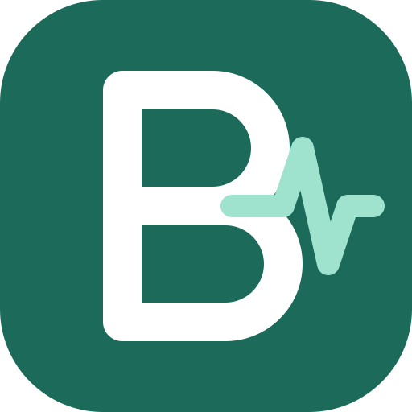

# Beni

A medical and nursing assistant for nursing students. Ask any health or nursing question and get an answer in plain, everyday language, or upload an assignment (PDF, text or photos) and get a clear draft to edit and save as a PDF.

## Features

- **Ask anything**: anatomy, diseases, drugs, lab values, ECGs, dosage calculations (with every step shown), exam questions, and follow-up questions in the same thread.
- **Assignment modes**: answer questions, essay or paper, care plan, case study, reflection, and "Explain it to me" for studying.
- **Uploads**: PDFs (text is read in the browser with pdf.js), text files and photos.
- **Options**: length, reference style (APA 7, Harvard, Vancouver) and year of study.
- **Editable draft** with word count, copy, and Save as PDF (jsPDF).

## How it runs

`beni.html` is a single page published as a Claude artifact. It calls Claude through the artifact runtime (`window.claude.use("sample")`) and saves PDFs through `window.claude.use("downloads")`, so answers only work when the page is opened inside Claude. Opened on its own in a browser, the page loads but the Ask and Save buttons are disabled.

## Files

- `beni.html`: the app
- `beni-logo.svg`: the logo

## Note

Beni is a study aid. It does not replace a mentor, a prescriber or local policy, and drafts should be read and rewritten in your own words before you hand them in.
